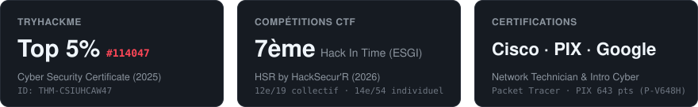
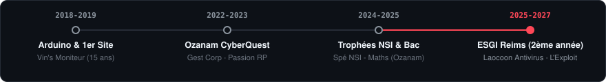

  

  <a href="https://grgoire.fr">grgoire.fr</a> &nbsp;·&nbsp;
  <a href="https://lexploit.fr">lexploit.fr</a> &nbsp;·&nbsp;
  <a href="https://tryhackme.com/r/p/grgoire">TryHackMe</a> &nbsp;·&nbsp;
  <a href="https://www.linkedin.com/in/gr%C3%A9goire-hernu-257042346/">LinkedIn</a>

 

Étudiant en **2ème année à l'ESGI Reims**, spécialisé en cybersécurité, et **directeur de publication** du journal numérique [**L'Exploit**](https://lexploit.fr).  
Mes travaux portent sur la sécurité offensive et défensive, l'analyse comportementale en sandbox isolée, les compétitions CTF et l'administration d'une infrastructure homelab sous **Proxmox VE**.

 

### Cybersécurité, CTF & Certifications

  

- **Cisco Networking Academy** - *Network Technician Pathway* (`3ec62cbc-881b-4eda-ab95-1bf475ca5b60`) · *Intro Cybersecurity* (`6dcf3838-3580-413a-8054-ce8558775e9a`) · *Packet Tracer* *(Janv. 2026)*
- **TryHackMe** - *Cyber Security Certificate* (`THM-CSIUHCAW47`, Janv. 2025) · Top 5% mondial (`#114047`)
- **PIX** (`P-V648H`, 643 pts) · **Google Digital Academy** (*Analytics* `171865041`, *AI-Powered Ads* `171951974`, *Creative Ads* `171888987`)

 

### Infrastructure & Homelab

Auto-hébergé sur **HP Z420 Workstation** (*Intel Xeon E5-2689 · 16 Threads · 110+ GiB RAM ECC · Stockage Proxmox ZFS*) sous **Proxmox VE** :

| Environnement | VMs / Services |
| :--- | :--- |
| **Lab Active Directory** | `Win-SRV01`, `Win-SRV02` et clients `Windows 10/11 Pro` |
| **Analyse de menaces** | `Laocoon Sandbox` (`Control`, `Cerveau`, VMs isolées) |
| **Production & IA** | `Serveurs L'Exploit`, `AI-Server`, `SRV-SSH & ALL-BOT` |
| **Services & Conteneurs** | `Vaultwarden`, `Docker-Media` (Jellyfin, *arr), `HomeAssistant`, `FreshRSS` |

**Outils & Environnements** · `Kali Linux` · `Nmap` · `Flipper Zero` · `TryHackMe` · `Cisco Packet Tracer` · `Proxmox VE` · `Active Directory` · `Debian` · `Windows Admin` · `Git` · `Python` · `Rust` · `C++` · `SQL`

 

### Projets & Réalisations

<table>
  <tr>
    <td width="50%" valign="top">
      <b>HERA NGFW</b> 2026-2027 
      Projet annuel de 2ème année à l'ESGI Reims : conception et développement d'un Next-Generation Firewall. 
      <code>NGFW</code> · <code>Cybersécurité</code> · <code>Réseau</code>
    </td>
    <td width="50%" valign="top">
      <b><a href="https://laocoon.grgoire.fr">Laocoon Antivirus</a></b> 2025-2026 
      Projet annuel de 1ère année : analyse comportementale, filtrage temps réel, quarantaine et sandbox cloud en VM isolée. 
      <code>Malware Analysis</code> · <code>Sandbox</code> · <code>Rust</code> · <code>C++</code> · <code>Tauri</code>
    </td>
  </tr>
  <tr>
    <td width="50%" valign="top">
      <b><a href="https://lexploit.fr">L'Exploit</a></b> Éditorial 
      Journal numérique indépendant dédié au décryptage des vulnérabilités, des réseaux et de l'actualité cyber (<i>Chroniques du Pare-Feu</i>, <i>Édito du Root</i>). 
      <code>Veille Cyber</code> · <code>Réseaux</code> · <code>Direction de publication</code>
    </td>
    <td width="50%" valign="top">
      <b><a href="https://github.com/grgoire-dev/OzanamCyberQuest">Ozanam CyberQuest</a></b> &amp; <b><a href="https://github.com/grgoire-dev/cyberVersionPython">Version Python</a></b> 
      CTF officiel du lycée Frédéric Ozanam (crypto, SQLi, analyse de code, stéganographie), refondu sous Flask/SQLAlchemy pour les Trophées NSI 2024. 
      <code>CTF</code> · <code>Python</code> · <code>Flask</code> · <code>PHP</code>
    </td>
  </tr>
  <tr>
    <td width="50%" valign="top">
      <b><a href="https://github.com/grgoire-dev/BOTOZANAM">Bot Discord CTF</a></b> &amp; <b><a href="https://github.com/grgoire-dev/botPassionRPFA">Bot Discord RP</a></b> 
      Bots Python : suivi temps réel des classements CTF, alertes de résolution et automatisation de services avec base SQLite. 
      <code>Python</code> · <code>SQLite</code> · <code>Discord API</code>
    </td>
    <td width="50%" valign="top">
      <b><a href="https://gest-corp.fr">Gest Corp</a></b> · <b>Musée Saint-Remi</b> · <b><a href="https://vins-moniteur.fr">Vin's Moniteur</a></b> · <b><a href="https://github.com/grgoire-dev/WebsitePassionRPFA">Passion RP</a></b> · <b><a href="https://grgoire-dev.github.io/Portfolio/">Portfolio V1</a></b> 
      Plateforme JSP Gest Corp (2023), app mobile Musée Saint-Remi (Dart/Flutter), sites web en production (depuis 2019) et Tablette RP. 
      <code>Dart</code> · <code>Flutter</code> · <code>PHP</code> · <code>Web</code>
    </td>
  </tr>
</table>

 

### Parcours

  

