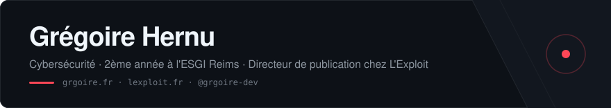

  

  
  
  
  

---

### Projets principaux

| Projet | Ce que c'est | Stack |
| :--- | :--- | :--- |
| **[Laocoon Antivirus](https://laocoon.grgoire.fr)** | Antivirus complet *(projet annuel 2025-2026)* avec analyse comportementale, filtrage temps réel et sandbox cloud en VM isolée. | <kbd>Rust</kbd> <kbd>C++</kbd> <kbd>Tauri</kbd> <kbd>JS</kbd> |
| **[L'Exploit](https://lexploit.fr)** | Journal numérique indépendant dédié à la cybersécurité, aux vulnérabilités et à la veille technique *(directeur de publication)*. | <kbd>Éditorial</kbd> <kbd>Cybersécurité</kbd> |
| **[Gest Corp](https://gest-corp.fr)** | Plateforme web dédiée à la gestion des Jeunes Sapeurs-Pompiers en France. | <kbd>PHP</kbd> <kbd>JS</kbd> <kbd>MySQL</kbd> |
| **[Ozanam CyberQuest](https://github.com/grgoire-dev/OzanamCyberQuest)** | Plateforme CTF officielle du lycée Frédéric Ozanam, présentée aux Trophées NSI 2024. | <kbd>Python</kbd> <kbd>Web</kbd> <kbd>CTF</kbd> |
| **Musée Saint-Remi** | Application dédiée à l'expérience visiteur du Musée Saint-Remi. | <kbd>Web</kbd> <kbd>Mobile</kbd> |
| **[Vin's Moniteur](https://vins-moniteur.fr)** & **Bots** | Site web en production depuis 2019, bots Discord (CTF & RP) et interfaces web embarquées. | <kbd>JS</kbd> <kbd>Node.js</kbd> <kbd>SQLite</kbd> |

---

### Cybersécurité & Certifications

| Compétitions & Plateformes | Certifications |
| :--- | :--- |
| **TryHackMe** - Top 5% mondial (`#114047`) | **Cisco** - *Network Technician Pathway* (2026) |
| **Hack In Time (ESGI)** - 7ème place (collectif) | **Cisco** - *Intro Cybersecurity* & *Packet Tracer* (2026) |
| **HSR by HackSecur'R (2026)** - 12ème/19 (coll.) · 14ème/54 (ind.) | **TryHackMe** - *Cyber Security Certificate* (2025) |
| | **PIX** (643 pts) · **Google Digital Academy** |

---

### Stack & Infrastructure

**Langages** · <kbd>Rust</kbd> <kbd>C++</kbd> <kbd>Python</kbd> <kbd>JavaScript</kbd> <kbd>PHP</kbd> <kbd>HTML5 / CSS3</kbd> <kbd>Java</kbd>  
**Données** · <kbd>MySQL</kbd> <kbd>SQLite</kbd> <kbd>MongoDB</kbd> <kbd>Firebase</kbd>  
**Sécurité & Systèmes** · <kbd>Kali Linux</kbd> <kbd>Nmap</kbd> <kbd>Flipper Zero</kbd> <kbd>Debian</kbd> <kbd>Proxmox VE</kbd> <kbd>Git</kbd>

> **Homelab auto-hébergé** - Station **HP Z420** *(Intel Xeon E5-2689 · 16 Threads · 110+ GiB RAM ECC · ZFS)* sous **Proxmox VE**, hébergeant des VMs et conteneurs LXC dédiés à la cybersécurité, au développement et aux services réseau.
